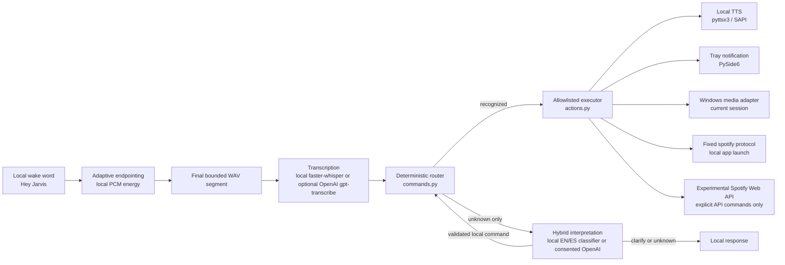

# DeskPilot Architecture

DeskPilot is a local-first Windows assistant built around deterministic routing and explicit execution allowlists.

## Native Flow

The native shell runs with `python -m deskpilot_backend.desktop`. Until `voice_setup_completed` is saved, it opens the setup dialog instead of starting wake listening, including when startup listening was previously enabled. After setup, listening remains off by default unless local settings enable it. When enabled, openWakeWord listens locally for "Hey Jarvis". On detection, DeskPilot stops the wake-word microphone stream and starts local adaptive command endpointing.

Endpointing is deterministic and local. DeskPilot reads short 16 kHz mono signed PCM frames, briefly calibrates against ambient audio after the recording cue, waits up to 3 seconds for consecutive frames above an adaptive RMS energy threshold, keeps a small pre-roll so command starts are not clipped, and ends capture after about 1.1 seconds of sustained trailing silence. The existing command capture duration setting remains the hard maximum, so noisy environments cannot keep the microphone open beyond the validated local limit. If no speech is detected, no audio is sent to transcription and DeskPilot reports that it did not hear a command.

Only the final bounded command WAV segment is sent to the selected transcription provider. The rest of the flow routes the resulting text through the deterministic command router and executes only allowlisted actions.

The overlay is visual feedback only:

- Cyan: listening for the command
- Amber: processing transcription and action handling
- Green: success
- Red: recoverable error or unknown command

## Command Routing

`commands.py` normalizes case, whitespace, and terminal punctuation, then maps exact English phrases to typed command responses. Parameterized commands exist only where explicitly implemented, such as bounded search, notes, and reminders.

The deterministic router is always the first path and built-ins take precedence over aliases. If it returns unknown, `intent_routing.py` selects local, cloud or automatic interpretation. The offline `local_interpreter.py` compares word/character TF-IDF vectors against reviewed EN/ES media examples, abstains on unsupported targets and negations, and asks for clarification at intermediate similarity. This is a lexical statistical classifier, not a conversational LLM; similarity is not a probability. Automatic uses local first; Cloud uses cloud first with local fallback. Both require explicit `cloud_processing_allowed=true` plus a key before any cloud request. Cloud interpretation may use the OpenAI Responses API with model `gpt-6-luna`, function calling, strict schemas, `store=false`, `parallel_tool_calls=false`, and exactly one accepted tool call. It sends only the current transcript plus static allowed-command metadata. It does not send notes, reminders, settings, history, file contents, or local paths.

The interpreter cannot execute anything. It may propose one existing fixed command ID, a note/reminder/search payload, a short clarification with up to two fixed-command choices, or unknown. Local code validates the result by routing it back through `commands.py` and executing only through `actions.py`.

## Allowlisted Execution

`actions.py` is the execution boundary. It uses fixed action types and targets for applications, websites, searches, media keys, Spotify controls, workspace shortcuts, system status, notes, reminders, and settings. DeskPilot never passes arbitrary text to a shell, executable path, URL opener, or filesystem path.

`open spotify` launches the fixed `spotify:` protocol using `ShellExecuteExW`, with shell error dialogs suppressed and launch errors propagated to UI/TTS. `play music` checks for a registered Spotify Windows media session, invokes that opener when needed, and requests play on the current Windows session. If no current session exists after launching, it polls briefly before returning a recoverable error. This path does not construct a Spotify API service or load tokens.

`windows_media.py` isolates Windows Global System Media Transport Controls. The controller accepts an injected manager factory for tests. WinRT namespaces are imported lazily on a private worker thread, which creates and uses the session objects and runs its own asyncio loop. Play and pause call distinct session methods; next and previous also target the current session. The adapter checks returned booleans and turns missing sessions, native failures, and timeouts into `MediaControlError`.

For a Spotify session, previous checks support and seeks an advanced track to its timeline start before sending exactly one previous request. It waits up to 1.5 seconds for the position update; rejected or unconfirmed seeks stop with an error. No second skip or play/pause toggle is sent. Other players use their native previous behavior. Mute and volume remain fixed system media keys and need no session.

`ActionExecutionError` carries execution failures through the assistant as `not_supported`, without an executed action. The native voice layer preserves the specific error text for TTS and the red overlay state.

`spotify.py` remains an experimental connector behind the same allowlist. `connect spotify` starts a browser-based Authorization Code flow with PKCE using only `SPOTIFY_CLIENT_ID`, the fixed redirect URI `http://127.0.0.1:8765/callback`, and the scopes `user-read-playback-state user-modify-playback-state`. A temporary callback server binds only to `127.0.0.1:8765`, validates state, accepts one callback, and shuts down. Explicit API commands such as `play spotify` call fixed Spotify HTTPS endpoints. They remain in the router/help for compatibility but are not invoked by public local media commands.

## Settings

Settings are stored in `~/Documents/DeskPilot/settings.json` and created only when missing. They control command capture duration, recording-start cue, wake listening on startup, transcription provider, command interpreter provider, default music app, and safe custom aliases. Invalid settings fall back to safe defaults without rewriting the user's file.

Custom aliases loaded from settings can only map a user phrase to an existing fixed command, such as `"open my projects": "open github"`. Validation rejects aliases that replace any built-in phrase, including fixed Spotify commands. Aliases cannot target media controls, notes, reminders, parameterized search, arbitrary URLs, paths, shell commands, or executables.

## Voice Setup

`voice_setup_ui.py` provides the first-run dialog and the tray's **Voice setup** entry. Device enumeration, the bounded microphone test, and model preparation run in daemon worker threads; Qt signals update the UI. Listening and command execution cannot overlap setup. Closing the dialog cancels acceptance of worker results; no settings are saved. A library download already in progress may finish in the background, and new listening is blocked until that job settles.

`audio_devices.py` enumerates only inputs and resolves a persisted `{name, hostapi}` identity to its current PortAudio index. The wake-word stream and native adaptive capture use the same selection; absent or ambiguous selections fail instead of switching silently. `null` follows the default input. The development API retains its existing default-microphone behavior.

`voice_setup.py` tests three seconds of local PCM energy without transcription or action execution. Its `VoiceModelResources` prepares and reuses a wake-word model and local `WhisperTranscriptionService`. Missing files download through the existing libraries. Progress reports real preparation stages, not byte percentages. The reused wake model is reset between listening sessions. Native startup also prepares models off the Qt UI thread.

Saving requires a successful microphone test for the selected input and ready models. `SettingsStore.save_voice_setup` rereads existing JSON, updates only setup-owned fields (plus providers when local mode is selected), and atomically replaces the file. Invalid JSON and unsupported versions are left intact. The native services receive the saved selection immediately without a restart.

## Notes And Reminders

Notes are local UTF-8 `.txt` files under `~/Documents/DeskPilot/notes`. DeskPilot generates note filenames internally and does not accept spoken paths or filenames.

Reminders are stored in `~/Documents/DeskPilot/reminders.json`. Pending reminders are reloaded on startup and scheduled locally. When due, DeskPilot shows a native tray notification and narrates `Reminder: <text>` using local TTS.

Spotify refresh tokens are stored under `~/Documents/DeskPilot` encrypted with Windows DPAPI for the current user. Access-token metadata is stored with the protected token and refreshed automatically when expired. `disconnect spotify` deletes only this local protected token.

## Safety Boundaries

DeskPilot is local-first. Media phrase understanding supports English and Spanish; the wake word, other exact commands and responses remain in English. Optional OpenAI transcription and command interpretation are explicitly configured by environment/settings and may incur API cost. Public Spotify Desktop/media control needs no Spotify API connection. Only the experimental Spotify Web API integration requires explicit connection and uses no client secret. DeskPilot does not execute arbitrary commands, accept arbitrary paths or URLs, run shell commands, automate desktop UI clicks, call OpenAI built-in tools, or listen continuously for full speech transcription. Wake-word detection only triggers a short bounded command capture.
